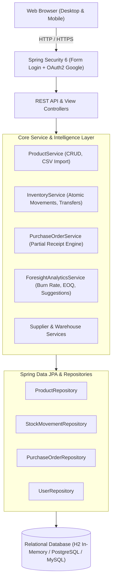

# Project Foresight - Technical Architecture & API Specifications

## 1. System Architecture Overview

Project Foresight follows an enterprise **Hexagonal Layered Architecture** built on Spring Boot 3 and Java 17/21.

---

## 2. Smart Foresight Forecasting Algorithms

Project Foresight eliminates stockouts through real-time mathematical demand modeling:

### 1. Velocity & Average Daily Demand ($D$)
Calculated from sales dispatches ($\Delta < 0$) over the past 30 days:
$$D = \frac{\sum |\Delta_{\text{outflow}}|}{30}$$

### 2. Days of Inventory Outstanding / Runway ($DIO$)
$$DIO = \frac{\text{Current Stock on Hand}}{D}$$

### 3. Safety Stock ($SS$) & Reorder Point ($ROP$)
Based on supplier delivery lead times ($L$ in days):
$$SS = \lceil L \times D \rceil$$
$$\text{Reorder Trigger} \iff \text{Current Stock} \le \text{Reorder Level}$$

### 4. Economic Order Quantity & Replenishment Recommendation ($Q^*$)
$$\text{Recommended Quantity} = \text{MaxStockLevel} - \text{CurrentStock} + SS$$

---

## 3. REST API Endpoint Summary

### Authentication (`/api/auth`)
- `POST /api/auth/register`: Register new account with role (`ADMIN`, `INVENTORY_STAFF`, `PURCHASING_STAFF`).
- `GET /api/auth/me`: Fetch authenticated user profile and roles.
- `GET /oauth2/authorization/google`: Gmail OAuth2 login flow.

### Product Management (`/api/products`)
- `GET /api/products`: Search and filter products with pagination.
- `GET /api/products/{id}`: Retrieve single product details.
- `POST /api/products`: Create new product (records initial movement if stock > 0).
- `PUT /api/products/{id}`: Update product details and quantity dynamically.
- `DELETE /api/products/{id}`: Soft delete / deactivate product.
- `GET /api/products/low-stock`: Filter items where `currentStock <= reorderLevel`.
- `POST /api/products/upload-csv`: Bulk import products from CSV spreadsheet.

### Inventory & Movements (`/api/inventory`)
- `POST /api/inventory/adjustment`: Record Stock-In, Stock-Out, or Audit Adjustment.
- `POST /api/inventory/transfer`: Inter-warehouse stock transfer.
- `GET /api/inventory/movements`: Immutable chronological movement audit ledger.

### Purchase Orders (`/api/purchase-orders`)
- `GET /api/purchase-orders`: List all orders with supplier & line-item details.
- `POST /api/purchase-orders`: Draft a new purchase order.
- `POST /api/purchase-orders/{id}/send`: Move status to `ORDERED`.
- `POST /api/purchase-orders/{id}/receive`: Record partial or full receipt with atomic stock updates.
- `POST /api/purchase-orders/{id}/cancel`: Cancel pending order.

### Analytics & Foresight Intelligence (`/api/analytics`)
- `GET /api/analytics/stats`: Real-time valuation, SKU counts, low stock counts.
- `GET /api/analytics/charts?timeframe=daily|weekly|monthly|yearly`: Chart series data.
- `GET /api/analytics/suggestions`: Predictive risk levels and reorder recommendations.
