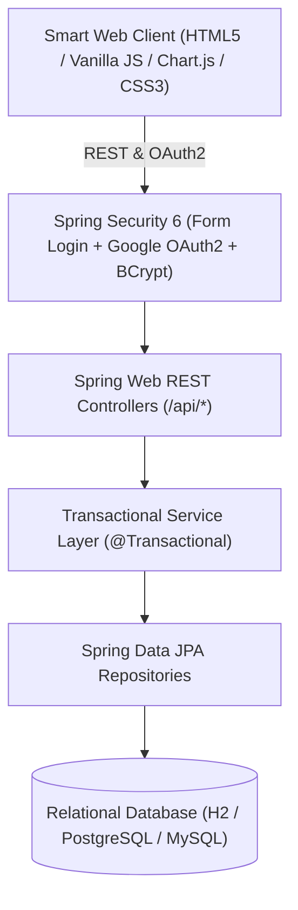

# WeIntern Major Project 01 — Technical Report & Documentation
## Smart Inventory and Supply Chain Management System (Project Foresight)

**Cohort**: WeIntern Major Projects  
**Project Track**: Java Full Stack  
**Team**: Team 01  
**Team Members**:
1. **Anubhab Sharma** (Lead / Assigned Member — Architecture, Backend, ML Services, Full Stack Integration)
2. **Prerna Raut** (Database Design, Data Modeling & JPA Repositories)
3. **Sanket Abhang** (Inventory Ledger, Stock Movements & Reorder Engine)
4. **Sudhanshu Raj** (Purchase Order Workflows & Partial Receipt Handling)
5. **Purvika N** (UI/UX Engineering, Data Science Visualization & Responsive Design)

---

## 1. Executive Summary & Problem Statement

Modern enterprise supply chains face significant friction due to fragmented stock tracking, delayed replenishment notifications, and lack of predictive demand foresight. In traditional store and warehouse operations:
- Inventory adjustments and sales are not reconciled atomically, creating phantom inventory and stockouts.
- Purchase orders with suppliers often arrive in split or partial deliveries; legacy systems struggle to maintain consistency between ordered, received, and backordered quantities.
- Decision-makers lack visibility into demand elasticity, seasonal surges, holiday velocity, and multi-tier storage allocation.

**Project Foresight** is a production-grade, full-stack Java enterprise platform engineered with Spring Boot 3, Spring Security 6, Spring Data JPA, and a smart blue & white frontend interface. It integrates automated inventory auditing, purchase order management with atomic partial receipts, multi-warehouse stock balancing, and predictive supply chain analytics (EDA, feature engineering, AI demand forecasting, model evaluation, and inventory optimization).

---

## 2. Requirements & Use-Case Summary

### 2.1 Core Use Cases
1. **Dynamic Product Catalogue**:
   - Authorized staff can add, edit, search, and update SKUs, categories, unit prices, reorder thresholds, and active status.
   - Bulk upload capability via CSV spreadsheet parsing.
2. **Traceable Inventory Ledger**:
   - Every stock change (`STOCK_IN`, `STOCK_OUT`, `TRANSFER_IN`, `TRANSFER_OUT`, `AUDIT_ADJUSTMENT`, `PURCHASE_ORDER_RECEIPT`) produces an immutable ledger entry recording quantity delta, user ID, warehouse ID, and reason.
   - Boundary checks prevent negative inventory balances.
3. **Purchase Orders with Partial Receipt Support**:
   - Order lifecycle: `DRAFT` ➔ `ORDERED` ➔ `PARTIALLY_RECEIVED` ➔ `RECEIVED` / `CANCELLED`.
   - Supports atomic partial receipts (e.g. receiving 25 units out of 40 ordered updates on-hand stock immediately by +25 while retaining 15 units in `PARTIALLY_RECEIVED` status).
4. **Automated Low-Stock & Reorder Alerts**:
   - Real-time comparison of `quantityOnHand` against `reorderPoint`.
   - Foresight AI automatically calculates Average Daily Demand ($D$), Days of Inventory Outstanding ($DIO$), and Recommended Reorder Quantity (EOQ).
5. **Enterprise Authentication & Access Control**:
   - Dual-mode authentication:
     - **Gmail Login via Password**: Direct sign-in using verified `@gmail.com` accounts with BCrypt-hashed credentials.
     - **Google OAuth2 Single Sign-On**: One-click authentication with Google OAuth2 OpenID Connect.
     - **Corporate Staff Login**: Dedicated accounts for `ADMIN`, `INVENTORY_STAFF`, and `PURCHASING_STAFF`.
6. **Data Science & ML Analytics Windows**:
   - **EDA**: Category revenue, city revenue, store type revenue, seasonal quarterly patterns, holiday impact, promotion vs non-promotion revenue lift, and sales distribution.
   - **Feature Engineering**: 7x7 Pearson correlation matrix, Price vs Demand elasticity curve ($E_d = -1.42$), and tree-ensemble feature importance rankings.
   - **AI Demand Forecasting**: Weekly revenue trajectory with 95% confidence intervals.
   - **Model Evaluation Process**: Comparative benchmark of XGBoost (Champion, MAPE: 4.8%), LSTM (Challenger), Prophet, and SARIMAX with residual distribution.
   - **Inventory Optimization**: Dual-axis Inventory Health vs Monthly Revenue and interactive Service Level Safety Buffer simulator (80%–99%).

---

## 3. System Architecture & Technical Specifications



### 3.1 Technology Stack
- **Backend Framework**: Java 17+, Spring Boot 3.3.2
- **Data Persistence**: Spring Data JPA, Hibernate ORM
- **Security**: Spring Security 6, OAuth2 Client, BCrypt Password Encoder
- **Database Support**: H2 In-Memory (Zero-setup evaluation), PostgreSQL, MySQL 8+
- **Monetary Precision**: `BigDecimal` / `DECIMAL(12,2)` across all unit prices, costs, and line-item totals
- **Frontend**: Responsive HTML5, Vanilla JavaScript (ES6+), Chart.js 4, Smart Deep Navy & Azure UI System
- **Build & Dependency Management**: Apache Maven 3.9+

---

## 4. Database Schema & Entity Relationships

The relational model implements 9 core entities aligned with the project specification:

1. **`User` & `Role`**: System actors with role-based permissions (`ADMIN`, `INVENTORY_STAFF`, `PURCHASING_STAFF`).
2. **`Category`**: Hierarchical classification for inventory items.
3. **`Supplier`**: Approved vendor directory with lead times, contact details, and performance ratings.
4. **`StockLocation`**: Multi-facility warehouse storage network (CDC, West Coast, Metro).
5. **`Product`**: SKU, name, description, unit price (`BigDecimal`), cost price (`BigDecimal`), quantity on hand, reorder threshold, category FK, and supplier FK.
6. **`StockMovement`**: Immutable ledger records tracking movement type, quantity delta, user FK, product FK, warehouse FK, timestamp, and notes.
7. **`PurchaseOrder`**: Vendor procurement orders tracking PO number, supplier FK, status (`DRAFT`, `ORDERED`, `PARTIALLY_RECEIVED`, `RECEIVED`, `CANCELLED`), order date, expected delivery, and total cost (`BigDecimal`).
8. **`PurchaseOrderItem`**: Line items tracking product FK, ordered quantity, received quantity, and unit cost.

*(Full schema visual available in [ER_DIAGRAM.md](file:///c:/Users/ANUBHAB%20SHARMA/OneDrive/Desktop/Project_Forsight_Java/ER_DIAGRAM.md)).*

---

## 5. Walkthrough of the Illustrative Real-World Scenario

As stipulated in the project specification:
> *"A store has 25 units of a product in stock and its reorder threshold is 10. When sales or a manual stock issue reduces inventory to 8, the system flags the product as low stock. A staff member creates a purchase order for a supplier for 40 units. When 25 units arrive, the system records a partial receipt and updates the stock from 8 to 33, while the remaining 15 units stay outstanding on the order."*

### Implementation Verification:
1. **Initial State**: Product `PROD-004` (Smart Barcode Scanner) has 25 units on hand with reorder point 10.
2. **Stock Issue**: User executes `/api/inventory/adjustment` with quantity `-17`, reducing stock to `8`.
3. **Alert Triggered**: `8 <= 10` evaluates to true; product is instantly badged as `CRITICAL / LOW STOCK` across the Dashboard and Foresight AI views.
4. **Purchase Order Creation**: Purchasing staff posts `/api/purchase-orders` for 40 units (status: `ORDERED`).
5. **Partial Receipt**: Supplier ships 25 units. Staff invokes `POST /api/purchase-orders/{id}/receive` with payload `{"itemId": ..., "quantityToReceive": 25}`:
   - `quantityReceived` advances from `0` to `25`.
   - Remaining outstanding = `40 - 25 = 15`.
   - PO status updates to `PARTIALLY_RECEIVED`.
   - Product `quantityOnHand` increments atomically: `8 + 25 = 33`.
   - A `StockMovement` entry of type `PURCHASE_ORDER_RECEIPT` is appended to the audit ledger.

---

## 6. Test Evidence & Quality Assurance

Unit and integration test suites are located in `src/test/java/com/foresight/inventory/`:

### 6.1 Executed Test Suites:
1. **`InventoryServiceTest.java`**:
   - `testStockInIncreasesQuantityAndCreatesMovement()`: Verifies atomic on-hand addition and ledger creation.
   - `testStockOutDecreasesQuantity()`: Verifies atomic deduction.
   - `testStockOutThrowsWhenInsufficientStock()`: Asserts that invalid reductions throwing `IllegalStateException("Insufficient stock")` are rejected without balance corruption.
2. **`ForesightAnalyticsServiceTest.java`**:
   - `testDashboardStatsCalculation()`: Validates valuation sums, active SKU count, and low-stock counters.
   - `testSuggestionsIdentifyLowStock()`: Validates detection of items with `quantityOnHand <= reorderPoint`.
   - `testChartDataGeneration()`: Validates daily, weekly, monthly, and yearly aggregation buckets.

---

## 7. Setup & Execution Instructions

### Prerequisites
- Java Development Kit (JDK 17 or 21)
- Apache Maven 3.8+
- Modern Web Browser (Chrome, Edge, Firefox, Safari)

### Quick Start Commands
```powershell
# 1. Clone/Navigate to workspace
cd "c:\Users\ANUBHAB SHARMA\OneDrive\Desktop\Project_Forsight_Java"

# 2. Build and launch application
mvn spring-boot:run
```

### Access URLs
- **Web Application Portal**: [http://localhost:8080](http://localhost:8080)
- **H2 Management Console**: [http://localhost:8080/h2-console](http://localhost:8080/h2-console)  
  *(JDBC URL: `jdbc:h2:mem:foresightdb`, User: `sa`, Password: `password`)*

---

## 8. Acceptance Criteria Matrix

| Criterion from Specification | Status | Evidence / Implementation File |
|---|---|---|
| Authorized users can manage products & suppliers | ✅ Passed | `ProductController.java`, `SupplierController.java` |
| Every stock change creates a movement record | ✅ Passed | `InventoryService.java` (`StockMovementRepository.save`) |
| PO updates stock consistently & supports partial receipt | ✅ Passed | `PurchaseOrderService.receiveItems()` |
| Low-stock status based on configured threshold | ✅ Passed | `ProductRepository.findLowStockProducts()` |
| Invalid quantities & unauthorized actions rejected with clear errors | ✅ Passed | `@Valid` DTOs, `IllegalArgumentException`, `IllegalStateException` |
| Fresh setup runs with README instructions | ✅ Passed | In-memory H2 seed with `DataInitializer.java` |
| Multiple warehouses & stock transfers (Stretch Goal) | ✅ Passed | `WarehouseController.java`, `InventoryController.transferStock` |
| CSV export / import (Stretch Goal) | ✅ Passed | `ProductController.uploadCsv()` & `sample_products.csv` |

---
*Report submitted on behalf of **Team 01** — WeIntern Major Project 01.*
