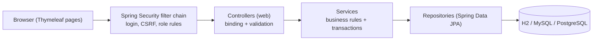
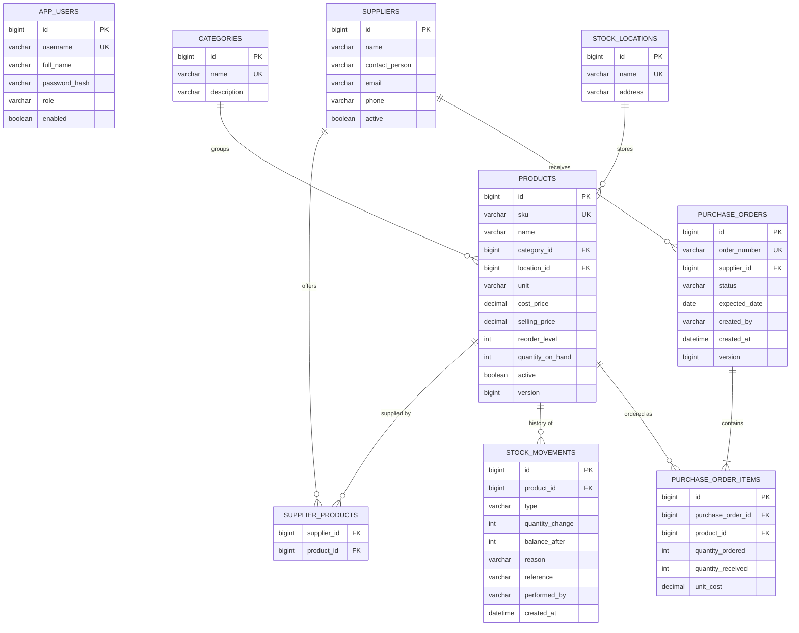
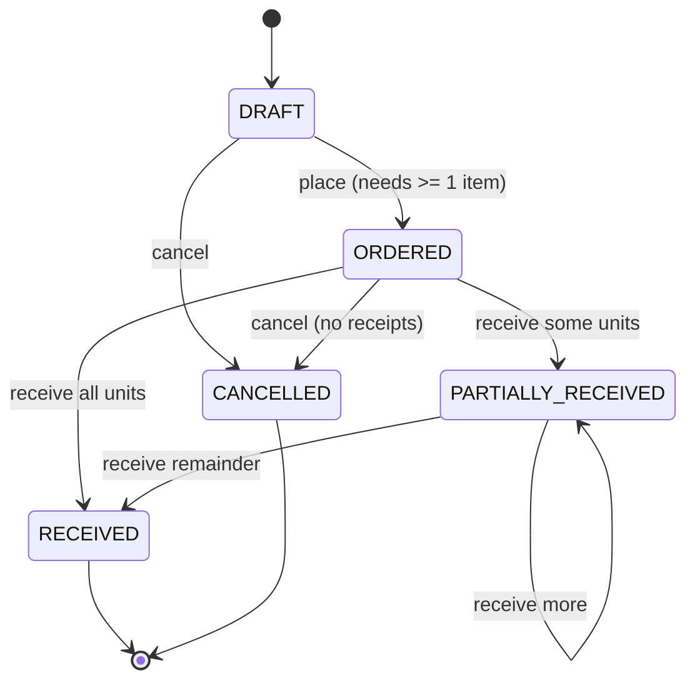
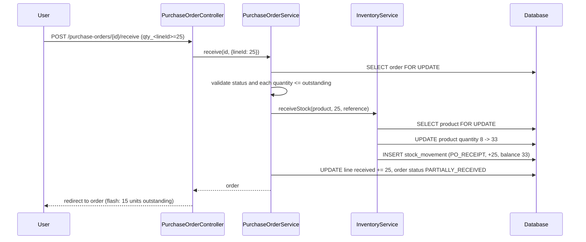

# Architecture Overview

## 1. Layers

- **Controllers** bind and validate form DTOs, call one service method, and choose a view or redirect.
- **Services** hold all business rules and own the transactions (`@Transactional`).
- **Repositories** provide queries and the pessimistic row locks used for stock changes.
- **Entities** are never bound directly to requests, which prevents mass-assignment (for example, posting a new `quantityOnHand`).

## 2. Entity-relationship diagram

`APP_USERS` is intentionally not linked by foreign key to movements and orders: the username is copied into
`performed_by` / `created_by` so history stays readable even if a user is later disabled.

## 3. Purchase-order lifecycle

## 4. Receiving goods (sequence)

Everything in the sequence runs in one transaction: either all of it is committed or none of it.

## 5. Concurrency and integrity

| Risk | Control |
|---|---|
| Two users change the same product at once | `SELECT ... FOR UPDATE` (pessimistic lock) in `ProductRepository.findByIdForUpdate`, used by every stock change |
| Two users receive the same order at once | `PurchaseOrderRepository.findByIdForUpdate` serialises receipts |
| Two users edit the same record form | `@Version` optimistic locking; a friendly 409 page is shown on conflict |
| Partial failure while receiving | Single transaction: all lines succeed or nothing changes |
| Negative or huge stock | Checked in `InventoryService.apply` before saving |

## 6. Security

- Authentication: form login, BCrypt hashes, session cookie `HttpOnly` + `SameSite=Lax`.
- Authorization: URL rules in `SecurityConfig` (server-side), plus view-level `sec:authorize` only to hide buttons.
- CSRF: enabled; every form posts a token (Thymeleaf `th:action`).
- Validation: Jakarta Bean Validation on DTOs + business checks in services; no entity is bound directly.
- XSS: Thymeleaf escapes all output by default (`th:text`).
- SQL injection: JPA/JPQL with bound parameters only.
- Error pages never show stack traces (`server.error.include-stacktrace=never`).
- Secrets: database credentials come from environment variables; none are committed.

### Permission matrix

| Action | Admin | Inventory | Purchasing |
|---|:-:|:-:|:-:|
| View dashboard, products, suppliers, ledger, orders | yes | yes | yes |
| Create/edit/archive products, manage categories | yes | yes | - |
| Record stock in / out / adjustment | yes | yes | - |
| Create/edit suppliers | yes | - | yes |
| Create, edit, place, cancel purchase orders | yes | - | yes |
| Receive purchase orders | yes | yes | yes |
| Manage users | yes | - | - |

## 7. Web routes

| Method and path | Purpose | Roles |
|---|---|---|
| GET `/` | Dashboard | all |
| GET `/products`, `/products/{id}` | List (search, category, low-stock filter, paging), details | all |
| GET/POST `/products/new`, `/products/{id}/edit`, POST `/products`, `/products/{id}`, `/products/{id}/archive` | Manage products | admin, inventory |
| GET/POST `/categories`, POST `/categories/{id}/delete` | List (all), manage (admin, inventory) | see matrix |
| GET `/suppliers`; GET/POST `/suppliers/new`, `/suppliers/{id}/edit` | List; manage | all; admin, purchasing |
| GET `/inventory` | Ledger with search and type filter | all |
| GET/POST `/inventory/transaction` | Record stock in/out/adjustment | admin, inventory |
| GET `/purchase-orders`, `/purchase-orders/{id}` | List, detail | all |
| GET `/purchase-orders/new`; POST `/purchase-orders`, `/{id}/items`, `/{id}/items/{itemId}/remove`, `/{id}/place`, `/{id}/cancel` | Create and manage | admin, purchasing |
| POST `/purchase-orders/{id}/receive` | Record receipt | admin, inventory, purchasing |
| GET/POST `/users`, `/users/new`, POST `/users/{id}/enabled` | User management | admin |

## 8. Deployment notes
Package with `mvn clean package` and run `java -jar target/smart-inventory-1.0.0.jar` with
`--spring.profiles.active=mysql` (or `postgres`) and the `DB_*` environment variables. Put the app behind HTTPS
(reverse proxy or platform TLS) and set `server.servlet.session.cookie.secure=true` when serving over HTTPS.
